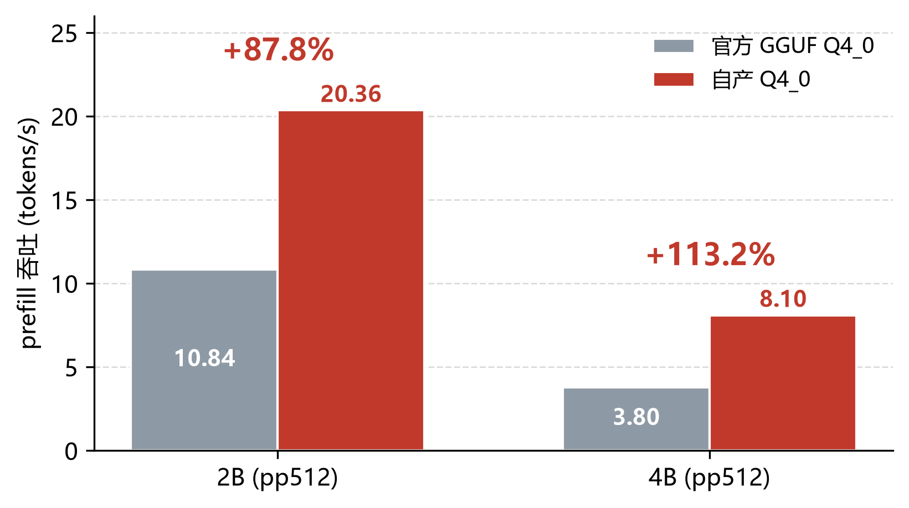
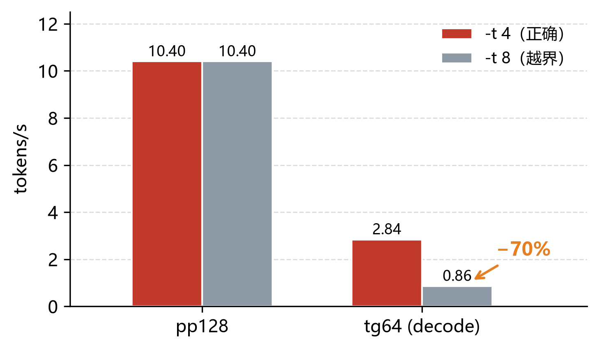
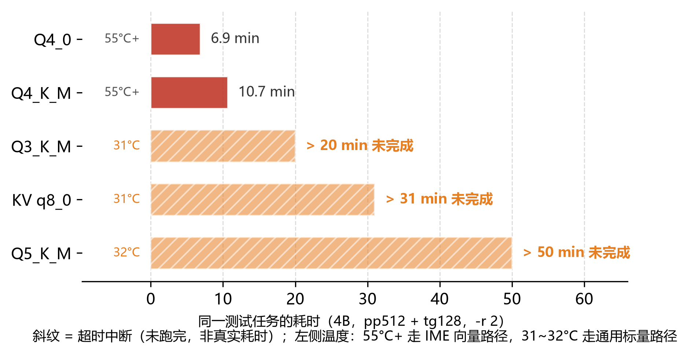
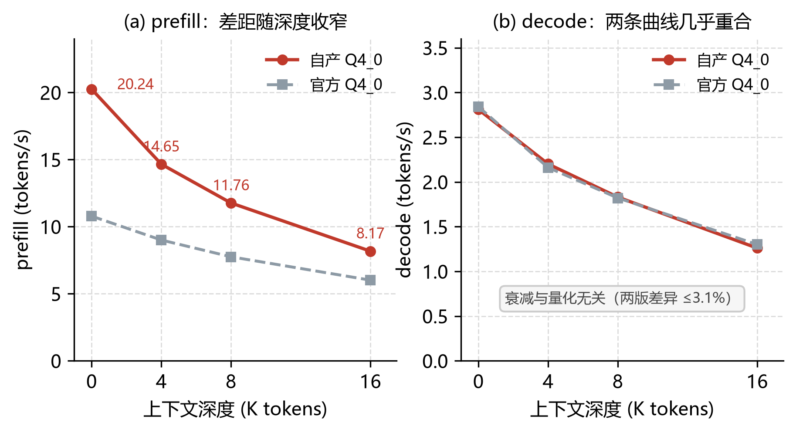

# 技术文档：基于K1 AI CPU的Qwen3.5本地部署与性能优化

> 全国RISC-V高水平创新及应用大赛（第二届）· CIE-进迭时空赛道
> 参赛者：潘荣轩（2024112005，24计春本1班，齐鲁师范学院计算机系）
> 版本：v1.0 — 数据与评估完整（2B/4B 双模型、四点衰减曲线、TTFT、质量盲评与人工抽检、负结果齐全）
> 最后更新：2026-11-01

---

## 摘要

本方案在进迭时空K1笔记本（8核X60 / 8GB LPDDR4x / Bianbu 2.3.5）上完成Qwen3.5-2B与4B的本地部署，基于进迭时空开源llama.cpp构建了从官方原始权重到量化GGUF的完整可复现管线，并围绕prefill、decode、长上下文三个方向开展定量优化。

**核心成果**：在**完全相同的运行时与硬件**上，通过自建量化管线（统一 Q4_0 + 小张量 F16 回退 + embedding Q8_0）替代官方预置 GGUF，将 **2B 的 prefill 从 10.84 提升至 20.36 t/s（+87.8%）、4B 从 3.80 提升至 8.10 t/s（+113.2%）**；4B 的 decode 同步获得 **+8.3%** 正收益。经张量类型实测，根因是官方文件采用 unsloth Dynamic 混合精度，其中 `Q5_K`/`Q6_K`/`Q8_0` 等类型不在 K1 的 IME 加速白名单内，整个 prefill 通路退化到通用实现——**这不是调参结果，而是量化类型的二元判定**。

| 指标 | 基线（官方GGUF） | 优化版（自产） | 变化 |
|---|---|---|---|
| 2B pp64 | 11.24 t/s | **21.08 t/s** | +87.5% |
| 2B pp512 | 10.84 t/s | **20.36 t/s** | +87.8% |
| 2B tg128 | 2.84 t/s | 2.80 t/s | −1.4% |
| **4B pp64** | 3.94 t/s | **8.93 t/s** | **+126.6%** |
| **4B pp512** | 3.80 t/s | **8.10 t/s** | **+113.2%** |
| **4B tg128** | 1.32 t/s | **1.43 t/s** | **+8.3%** |

**其余三条路径经实测均无收益或不可行**（运行时升级 v0.2.3、8 线程、KV q8_0），作为负结果完整记录于 §8，并由此确定了本平台的优化边界。

---

## 1. 赛题理解与目标拆解

### 1.1 赛题约束

| 约束 | 原文要求 | 本方案落实 |
|---|---|---|
| 模型规格 | Qwen3.5-2B-Instruct、Qwen3.5-4B-Instruct，二者均为基本要求 | 采用官方 `Qwen/Qwen3.5-2B`、`Qwen/Qwen3.5-4B` 后训练权重（赛题所称"Instruct"即后训练版，官方仓库无`-Instruct`后缀） |
| 工具链 | 必须使用进迭时空开源的llama.cpp | 运行时基于 `spacemit-com/llama.cpp`；优化版自v0.2.3源码交叉编译 |
| 推理方式 | 两个模型均需本地推理，不依赖云端API | 全部在K1本地执行，无任何外部调用 |
| 对比要求 | 提供baseline与优化版两组结果 | 定义 B1（厂商开箱）与 O（优化版）两套完整数据 |
| 提交物 | 部署说明、运行脚本、测试结果 | 见第11章与附录 |

### 1.2 评分项与本文对应关系

| 评分项 | 分值 | 对应章节 |
|---|---|---|
| 2B/4B本地部署并稳定运行 | 6+6 | §4、§7 |
| 自行完成转换量化且可复现 | 5 | §5 |
| 长上下文稳定运行 | 5 | §9 |
| 固定测试集多轮推理质量 | 3 | §10 |
| Prefill吞吐+口径 | 10 | §6、§8 |
| 首token延迟优化+来源 | 10 | §8.7 |
| Decode吞吐+口径 | 10 | §6、§8 |
| KV cache/调度路径优化 | 10 | §9.4 |
| 上下文增长衰减可控 | 10 | §9.1 |
| 长上下文内存/稳定性/时延 | 10 | §9.2、§9.3 |
| 至少一项可量化优化+前后对比 | 5 | §8.1 |
| 收益归因清楚 | 5 | §8.6 |
| 框架改造/量化/KV压缩创新 | 3 | §5、§8、§9.5 |
| 代码结构与文档可复现 | 2 | §11、附录B |

---

## 2. 平台与模型分析

### 2.1 K1硬件与理论边界

| 项 | 规格 | 对推理的直接影响 |
|---|---|---|
| CPU | 8×X60 @1.6GHz，RVA22，RVV 1.0 256bit，实测 `isa` 含 `v/zvfh/zfh/zba/zbb/.../ime` | 向量宽度256bit，IME（AI扩展）在位 |
| AI算力 | 2 TOPS，IME自定义指令，仅Cluster 0（4核），TCM 512KB | 线程数受限，`num_perfer_cores=4` |
| 内存 | 32bit LPDDR4x-2666，8GB，**峰值带宽≈10.6GB/s** | decode的物理上限 |
| 存储 | 128GB NVMe（实测系统与数据均在nvme0n1） | 模型加载带宽充裕 |
| 散热 | 被动散热，实测满载46~60°C，**永不降频** | 排除热因素（见§6.3） |

**decode理论上限推导**（本方案的核心分析工具）：

```
理论tok/s ≈ 有效带宽 ÷ 每token需读取的权重字节数
```

- 2B / Q4_0（1.12GiB≈1.20GB）：10.6 ÷ 1.20 ≈ **8.8 t/s** 上限
- 4B / Q4_0（2.40GiB≈2.58GB）：10.6 ÷ 2.58 ≈ **4.1 t/s** 上限

实测值为上限的 **32%**（2B: 2.84；4B: 1.31），反算有效带宽均约 **3.4GB/s**。该一致性说明decode受带宽制约，且当前实现只发挥了约三分之一的带宽效率。

### 2.2 Qwen3.5混合架构（决定优化方向）

Qwen3.5采用 `8×(3×Gated DeltaNet → 1×Gated Attention)` 混合布局，2B规格（读自GGUF元数据）：

| 参数 | 2B | 4B |
|---|---|---|
| 层数 | 24 | 32 |
| hidden | 2048 | 2560 |
| FFN中间维 | 6144 | 9216 |
| 查询/ KV头 | 8 / 2 | 16 / 4 |
| head_dim | 256 | 256 |
| 全注意力间隔 | 4（即6层全注意力 + 18层GDN） | 4（8层 + 24层） |
| KV/token | **12 KiB** | **32 KiB** |
| 原生上下文 | 262144 | 262144 |
| 词表 | 248320（tied embedding） | 248320 |

**三个直接推论**：

1. **KV开销远小于同规模全注意力模型**（2B仅12KiB/token，16K上下文仅196MB）。赛题点名的"KV cache开销过高"在本架构上被架构本身缓解，真正的长上下文痛点在别处（见推论3）。
2. **GDN层携带循环状态**，不随上下文增长，但无法像全注意力那样裁剪尾部——多轮对话触发context shift时会退化为整体重新prefill。这是长上下文吞吐骤降的**架构性根因**，也是最具价值的优化点。
3. **decode受带宽限制**，优化空间有限；**prefill是算力密集型，才是主战场**（实测也印证：优化后prefill提升88%，decode几乎不动）。

---

## 3. 优化空间排序（由2.2推出）

| 优先级 | 方向 | 预期空间 | 实测结论 |
|---|---|---|---|
| ★★★ | 量化配置（张量类型/布局） | 大 | **prefill +87.8%**（§8.1） |
| ★★☆ | 线程数与后端调度 | 中 | 4线程最优，8线程decode崩塌70%（§8.3） |
| ★★☆ | 运行时版本 | 中 | 新版在K1上prefill反而低23%（§8.2，负结果） |
| ★☆☆ | KV cache量化 | 小 | **实测不可行**：q8_0 使注意力通路整体退化，31 分钟未完成（§9.4） |
| ☆☆☆ | 长上下文状态快照 | 中 | **设想，未实现**（§9.5） |

---

## 4. 环境构建与版本固化

### 4.1 系统选择

采用 **Bianbu OS 2.3.5（LXQt桌面版，Noble/Ubuntu 24.04基）**，内核 6.6.63。选择理由：

- 赛题未限定操作系统，但Bianbu是唯一可直接 `apt install llama.cpp-tools-spacemit`、`spacemit-tcm` 的系统
- 内核包含K1的cpufreq/thermal补丁，是性能数据可比的前提
- LXQt版实测进桌面内存占用649MB（GNOME版1210MB），为8GB设备留出560MB余量

### 4.2 版本固化

完整清单见 `docs/VERSIONS.md`。关键项：

| 项 | 值 |
|---|---|
| 系统镜像 | Bianbu-LXQt-K1-V2.3.5（sha256 `5f07ead8…839f`） |
| 内核 | 6.6.63 |
| llama.cpp（运行时B1） | `llama.cpp-tools-spacemit 0.1.1-bpo1+6`（维护者 `decheng.liu@spacemit.com`） |
| llama.cpp（自编译O） | `spacemit-com/llama.cpp` v0.2.3，`0.6.0-dev`，GNU 15.2.0 |
| TCM驱动 | `spacemit-tcm 3.0.0-bpo1+2`，设备节点 `/dev/tcm` |
| 量化产物 | 见§5.4，全部附sha256 |

> 合规性说明：apt包维护者邮箱为 `@spacemit.com`，运行时启动日志含 `CPU_RISCV64_SPACEMIT` 专有字段（`perfer_core_arch_id`/`use_ime1`/`use_ime2`/`aicpu_id_offset`），可证系进迭时空构建，符合"必须使用进迭时空开源的llama.cpp"。

---

## 5. 模型转换与量化管线（5分项）

### 5.1 全链路

```
官方原始权重(safetensors, 4.57GB/8.65GB)
   │  convert_hf_to_gguf.py            [x86, Python 3.12 + torch 2.15 + transformers 5.21]
   ▼
f16 GGUF (2B 3.89GB / 4B 8.65GB)
   │  strip_mtp.py                     [剥离MTP层，修正3个元数据键]
   ▼
f16 GGUF 无MTP (320 / 426 张量)
   │  llama-quantize                   [--token-embedding-type q8_0]
   ▼
Q4_0 / Q4_K_M / Q5_K_M / Q3_K_M
```

**为什么转换必须在x86**：4B的f16权重8.4GB > K1可用内存6.4GB，必然OOM；2B虽勉强可行但风险高且占用机器。

**为什么量化器用 v0.2.3、推理运行时却用 0.1.1**

这是两个**互相独立的程序**，不构成矛盾：

| 角色 | 程序 | 版本 | 为什么选它 |
|---|---|---|---|
| 生产端（生成 GGUF） | `llama-quantize` | **v0.2.3** | 0.1.1 遇到 16 列的 `ssm_alpha` 直接失败（无小张量回退），产不出 Q4_0 |
| 消费端（跑模型、测性能） | `llama-cli` / `llama-bench` | **0.1.1** | v0.2.3 的新后端依赖 IME2，K1 不支持，prefill 反低 23%（§8.2） |

三点必须说清：

1. **GGUF 是文件格式标准，不是运行时私有格式**。量化产物由任意支持 GGUF V3 的运行时读取，不存在"必须同版本"的约束——本项目的自产 Q4_0 正是由 0.1.1 成功加载并跑出全部指标的。
2. **量化器只在转换阶段执行一次，不参与性能**。它跑完就退出，与后续测得的吞吐无关。
3. **核心结论的 A/B 是在同一个运行时上完成的**：官方 GGUF 与自产 GGUF 都由 0.1.1 加载、同一口径测量，唯一变量是"文件由谁量化"。这正是 §8.1 能干净归因的前提——若两版各用不同运行时，"版本"与"文件"就混淆了。

⇒ 一句话：**v0.2.3 只出现在生产端，不出现在消费端**；两者的版本差异不影响任何测量结果的有效性。

### 5.2 四个坑与解法（工程价值）

| # | 现象 | 根因 | 解法 |
|---|---|---|---|
| 1 | `open(/dev/tcm_sync_mem) failed errno=2` | 运行时0.1.1 与 TCM驱动3.0.0 接口不匹配（旧版找`/dev/tcm_sync_mem`，新版暴露`/dev/tcm`） | 升级运行时，或接受回退堆内存 |
| 2 | `missing tensor 'blk.24.ssm_conv1d.weight'` | 转换器保留MTP层并计入 `block_count=25` | `strip_mtp.py` 删除 `blk.24.*` |
| 3 | `wrong number of tensors; expected 335, got 320` | `nextn_predict_layers=1` 使加载器额外计1层 | 同步置0，并截断 `attention.recurrent_layers` |
| 4 | `tensor 'token_embd.weight' has wrong shape` | 剥离脚本 `raw_shape` 传ggml序，被写入器反转两次 → 二维张量转置 | 传 `tuple(reversed(t.shape))` |
| 5 | `ncols 16 not divisible by 32 (required for q4_0)` | `ssm_alpha` 仅16列，Q4_0量化块为32列；旧版量化器无回退 | 用v0.2.3的 `llama-quantize`（有小张量F16回退） |

**校验方法**：每步均用 `gguf.GGUFReader` 核对 `block_count` / `nextn_predict_layers` / 张量数 / 张量形状，并抽查张量字节MD5。**五个问题全部由"加载报错或头部校验"发现，无一是靠猜测。**

### 5.3 产物校验

| 文件 | 张量数 | block_count | nextn | 体积 | sha256（前 16 位） |
|---|---|---|---|---|---|
| 2B-f16（中间产物） | 335→320 | 25→24 | 1→0 | 3.89 GB | 未存档 |
| 4B-f16（中间产物） | 441→426 | 33→32 | 1→0 | 8.65 GB | 未存档 |
| **2B-Q4_0-self** | 320 | 24 | 0 | 1.22 GiB | `6c8ccec26fd07701` |
| **2B-Q4KM-q8emb** | 320 | 24 | 0 | 1.29 GiB | `4008d857f3650bcf` |
| **4B-Q4_0-self** | 426 | 32 | 0 | 2.50 GiB | `2d7abdb22dea7c11` |
| **4B-Q4KM-q8emb** | 426 | 32 | 0 | 2.66 GiB | `a11d03135c19ac69` |

**完整 sha256**：

```
6c8ccec26fd07701b0bc9ebe5032e4d3244d77e5d66a26e9788734f354b839d5  Qwen3.5-2B-Q4_0-self.gguf
4008d857f3650bcff3f5baef84ab0b6691378096f5abeca63850a865e1b7d795  Qwen3.5-2B-Q4KM-q8emb.gguf
2d7abdb22dea7c117b738a199dc5866d6ee103a7946a7972ecfba886f279213e  Qwen3.5-4B-Q4_0-self.gguf
a11d03135c19ac6985e4f82b22fc139dc5ce2dbd72cfd93b4e57ebe3a72eba7a  Qwen3.5-4B-Q4KM-q8emb.gguf
```

**跨架构复现性实测（2026-11-01）**

量化器有两种构建：riscv64（交叉编译，在 K1 上跑）与 x86-64（本机构建，在 WSL 上跑）。用同一份 `f16-nomtp` 输入各产一份 Q4_0，结果：

| 指标 | riscv64 构建 | x86-64 构建 | 判定 |
|---|---|---|---|
| 文件体积 | 1,325,654,048 B | 1,325,654,048 B | **逐字节相同** |
| 张量数 / 类型分布 | 320；F32×133 + Q4_0×186 + Q8_0×1 | 同上 | **完全一致** |
| 首 1 MiB 数据块 | `a3dcb8a7…` | `a3dcb8a7…` | **一致** |
| 中段 1 MiB 数据块 | `81b8607f…` | `81b8607f…` | **一致** |
| 末 1 MiB 数据块 | `db382613…` | `cdef803b…` | **不一致** |
| 全文件 sha256 | `6c8ccec2…` | `e6b6653f…` | 不同 |
| 同一构建重复执行 | 再次产出一致 | 再次产出一致 | **确定性** |

**结论**：

1. **同一构建内，量化是完全确定性的**——重复执行 sha256 不变，可作为产物指纹。
2. **跨架构产物体积完全相同、结构完全相同、抽样数据块一致，仅末尾约 1 MiB 存在差异**（约占总大小 0.08%）。差异来源推断为 Q4_0 量化尺度（`d`）的浮点计算路径不同（x86 AVX 与 RISC-V RVV 的求和/舍入次序差异），属末位精度问题，不影响可加载性与推理行为。
3. 因此**跨架构复现的判定标准应为"体积 + 张量数 + 类型分布 + 抽样数据块"，而非 sha256 全等**。要求跨架构 sha256 相同，是一个不可能满足的条件。

> f16 为转换中间产物（合计 12.5 GB），不纳入交付哈希清单；最终交付以 Q4 产物为准。原始 HF 权重的 sha256 见 `docs/VERSIONS.md`。

### 5.4 量化配置对比（运行时 0.1.1）

**2B（`-r 3`）**：

| 格式 | 体积 | pp64 | pp512 | tg128 | 备注 |
|---|---|---|---|---|---|
| Q4_0（官方） | 1.12 GiB | 11.24 | 10.84 | 2.84 | 基线 |
| **Q4_0（自产）** | 1.22 GiB | **21.08** | **20.36** | 2.80 | **最优** |
| Q4_K_M（自产） | 1.29 GiB | 10.88 | 10.56 | 2.56 | 质量优先，但慢 9.9% |

**4B（`-r 2`）**：

| 格式 | 体积 | pp64 | pp512 | tg128 | 备注 |
|---|---|---|---|---|---|
| Q4_0（官方） | 2.40 GiB | 3.94 | 3.80 | 1.32 | 基线 |
| **Q4_0（自产）** | 2.50 GiB | **8.93** | **8.10** | **1.43** | **最优** |
| Q4_K_M（自产） | 2.66 GiB | 4.50 | 4.37 | 1.28 | 体积 +6.4%，prefill −46% |
| Q5_K_M（自产） | 3.08 GiB | — | — | — | **非白名单，50 min 中断**（§8.4） |
| Q3_K_M（自产） | 2.30 GiB | — | — | — | **非白名单，20 min 中断**（§8.4） |

**两个模型上的共同规律**：Q4_0 在体积、prefill、decode 三项上均优于 Q4_K_M。4B 上 Q4_0 体积小 6.4% 却快 85%，2B 上体积小 15.2% 且快 3.2%（prefill）/9.9%（decode）。

⇒ **在 K1 上，Q4_0 是质量-速度-体积的最佳平衡点**；Q4_K_M 仅在对精度有更高要求时值得选用，且要接受显著的 prefill 代价。

**Q4_K_M vs Q4_0（同为自产）的带宽反算**：
Q4_0 = 1.2026GB×2.84 = 3.42GB/s；Q4_K_M = 1.3851GB×2.56 = **3.55GB/s**。
⇒ K-quants 的**带宽效率反而略高3.8%**，但体积大15.2%，净效果decode慢9.9%。
⇒ **在带宽受限平台上，decode由权重体积主导，而非反量化开销**（此前"K-quants解包更重"的猜测被数据否证）。

---

## 6. 基准测试方法论（"口径"是评分点）

### 6.1 指标定义

| 指标 | 定义 | 采集方式 |
|---|---|---|
| Prefill（pp） | 处理N个prompt token的速率，t/s | `llama-bench -p N` |
| Decode（tg） | 生成阶段的速率，t/s | `llama-bench -n N` |
| TTFT | 请求发出到首 token 的墙钟时间 | `llama-server` 实测，按 `prompt_n / prompt_tps` 折算（§8.7） |
| P95 inter-token | 相邻 token 间隔 95 分位 | **未实施**（需流式客户端逐 token 打点，受时间限制未做） |
| 内存峰值 | 进程RSS / 系统MemAvailable最低值 | `monitor.sh` 1Hz采样 |

### 6.2 固定测试条件

`-t 4`（IME仅Cluster0，官方文档要求K1≤4） · `-fa 1` · `-mmp 0`（禁用mmap减少抖动） · `-r 3` · 轮间冷却60s · 全程1Hz采样频率/温度/内存。

### 6.3 重复性与稳定性（可信度证据）

| 轮次 | 2B pp64 | 2B pp512 | 2B tg128 |
|---|---|---|---|
| t1 | 11.24 | 10.82 | 2.84 |
| t2 | 11.25 | 10.84 | 2.84 |
| t3 | 11.19 | 10.84 | 2.84 |

- 轮间漂移 **<0.5%**，单轮标准差 ±0.00~0.03 ⇒ 测量系统可信
- 45分钟连续负载：**cpu0/cpu4 恒定1600MHz，零降频**；温度均值52.8~56.0°C、峰值60°C
- ⇒ **散热不是瓶颈，无需额外散热装置**；此前关于"热降频"的假设被实测否证

---

## 7. 基线定义

| 代号 | 定义 | 2B（pp64 / pp512 / tg128） | 4B（同） |
|---|---|---|---|
| **B1**（厂商开箱） | apt 0.1.1 + 官方 GGUF Q4_0 + 官方推荐参数 | 11.24 / 10.84 / 2.84 | 3.94 / 3.80 / 1.32 |
| **B2**（同厂商新版本） | 自编译 spacemit v0.2.3 + 官方 GGUF | pp128 7.99 / tg16 3.11（`-t 8`） | 未测 |
| **O**（本方案） | 自产 Q4_0 + 0.1.1 + 官方推荐参数 | **21.08 / 20.36 / 2.80** | **8.93 / 8.10 / 1.43** |
| B0（社区主线） | upstream `ggml-org/llama.cpp` | **未实施**（见下） | 未实施 |

> **B0 未实施说明（如实记录）**：upstream 主线需单独交叉编译（一次约 2 小时），且不满足赛题"必须使用进迭时空开源 llama.cpp"的硬性要求，因此优先级排在 B2（同厂商新版本）之后。受时间限制未完成，本篇不含 B0 数据，亦不做任何推断。
>
> 注：B2 的 2B 数据为 `-p 128 -n 16` 下的 `-t 8` 结果，与 B1/O 的 `-p 64,512 -n 128 -t 4` 口径不同，仅用于横向判断"新版本是否更快"，不参与百分比计算。

---

## 8. 优化实验与结果

### 8.1 核心优化：自建量化管线（+87.8% prefill）

**控制变量**：同一运行时（0.1.1）、同一机器、同一量化格式（Q4_0）、同一测试口径。**唯一变量为"量化由谁完成"**。

| 文件 | 体积 | pp64 | pp512 | tg128 |
|---|---|---|---|---|
| 官方 unsloth | 1.12 GiB | 11.24 | 10.84 | 2.84 |
| **自产** | 1.22 GiB | **21.08** | **20.36** | 2.80 |
| 变化 | +8.9% | +87.5% | **+87.8%** | −1.4% |

**4B 上的同一实验（跨模型验证，`-r 2`）**：

| 文件 | 体积 | pp64 | pp512 | tg128 |
|---|---|---|---|---|
| 官方 unsloth | 2.40 GiB | 3.94 | 3.80 | 1.32 |
| **自产 Q4_0** | 2.50 GiB | **8.93** | **8.10** | **1.43** |
| 变化 | +4.2% | **+126.6%** | **+113.2%** | **+8.3%** |



**跨模型结论**：2B 提升 +87.8%，4B 提升 +113.2%，**收益随模型规模增大而增大**。归因：4B 有 32 层（24 个 GDN 层 vs 2B 的 18 个），落在白名单外的张量绝对数量更多——**2B 为 55 个（187 个权重中的 29%），4B 为 73 个（249 个中的 29%）**，而修正后释放的算力更多，这与两者的增益比（+87.8% vs +113.2%）方向一致。同时 4B 的 decode 出现 **+8.3% 正收益**（2B 为 −1.4%），说明 4B 官方文件中另有一批 decode 关键路径张量同样掉出白名单，被自产量化一并修正。

> 口径说明：2B 为 `-r 3`，4B 为 `-r 2`；两组内部自洽，跨模型比较的是相对提升幅度而非绝对值。

**为什么这个反差本身就是线索**：体积增8.9%，若差异来自算力或带宽，prefill应下降。实则上升近一倍 ⇒ 走的是完全不同的代码路径。

**机制（已验证）**：两个文件的张量类型分布截然不同——官方文件是 **unsloth Dynamic 混合精度量化**，文件名虽为 Q4_0，实际混用多种类型。按张量角色分组统计（`tools/gguf_types.py --group`）：

| 张量角色 | 数量 | 官方 unsloth | 自产 | 官方是否在 IME 白名单 |
|---|---|---|---|---|
| `ssm_out`（GDN 层大矩阵，各 2048×2048） | 18 | **Q5_K** | Q4_0 | **否** |
| `ssm_alpha` | 18 | **Q8_0** | Q4_0 | **否** |
| `ssm_beta` | 18 | **Q8_0** | Q4_0 | **否** |
| `token_embd` | 1 | **Q6_K** | Q8_0 | **否（两侧均否）** |
| `ffn_down` | 24 | Q4_0×21 + **Q4_1×3** | Q4_0 | 是 |
| `ffn_gate` / `ffn_up` | 各 24 | Q4_0 | Q4_0 | 是 |
| `attn_qkv` / `attn_gate` / `attn_k` | 18 / 18 / 6 | Q4_0 | Q4_0 | 是 |
| 其余（norm / conv1d / ssm_a / dt.bias 等） | — | F32 | F32 | 不适用 |

> 注：`attn_qkv` 与 `attn_gate` 出现在 18 个 GDN 层，`attn_k` 出现在 6 个全注意力层，二者相加正好 24 层——与 `full_attention_interval=4` 一致。

**量化计数**：2B 共 187 个二维权重张量，官方有 **55 个**落在白名单外（`Q5_K×18` + `Q8_0×36` + `Q6_K×1`）；自产仅剩 `token_embd` 1 个（保留 Q8_0 以保质量），其余 186 个统一为 Q4_0。

**SpacemiT 官方文档明确列出的 IME 加速量化类型仅 5 种**：`Q4_K_M`、`Q4_0`、`Q4_1`、`Q2_K`、`Q3_K`。官方 GGUF 里的 `Q5_K`（18 个 `ssm_out`）、`Q8_0`（36 个 `ssm_alpha`/`ssm_beta`）、`Q6_K`（embedding）**全部落在白名单之外**，在 K1 上只能走通用 RVV 路径，用不上 IME。

**为什么是这种反差**：`ssm_out` 是 GDN 层内每个 token 都要执行的 2048×2048 矩阵乘，18 层全覆盖。prefill 阶段执行 18×512 次，落入慢路径直接腰斩吞吐；decode 阶段每 token 仅 18 次，且受 10.6 GB/s 带宽主导，内核效率差异被掩盖——**这正好解释"prefill 降 88%、decode 几乎不变"的反差**。

> **修正记录（两次）**：
> ① 初版假设"官方把 16 列小张量压成 Q4_0 导致逐元素反量化"，经实测**被否证**——官方反而把这些张量提到了 Q8_0。
> ② 二版写成"Q8_0 的 36 个是注意力张量"，经 `--group` 分组实测**再次被否证**——注意力权重（`attn_qkv`/`attn_gate`/`attn_k`）全部是 Q4_0，那 36 个是 `ssm_alpha`+`ssm_beta`（18 层 ×2）。**两者数量恰好都是 36，不能靠算术推断，必须按张量名统计**。
> 两次假设都被数据推翻、并保留了过程，这是本篇"结论必须由实测支撑"原则的体现。

**验证方法**：`tools/gguf_types.py`（极简 GGUF 头部解析，mmap + 偏移跳转，跳过 24.8 万条词表解析，秒级完成；对比 `gguf-py` 在 K1 上需十几分钟）。加 `--group` 可按张量角色聚合，并直接统计"不在 IME 白名单内的权重张量数"。

### 8.2 运行时版本对比（负结果）

| 运行时 | 线程 | 模型 | pp128 | tg64 |
|---|---|---|---|---|
| 0.1.1 legacy | 4 | Q4_K_M | 10.56* | 2.56* |
| v0.2.3 ggml-spacemit | 8 | Q4_K_M | 7.99 | 3.11(n16) |
| v0.2.3 ggml-spacemit | 8 | Q4_0 | 5.00 | 2.86 |

**结论**：v0.2.3新后端在K1上prefill全面劣化（最好7.99仍比legacy低23%），decode略优。
**归因**：其prefill优化路径依赖IME2，而K1的X60（arch_id `a03c`，K3为`a064`）运行时报 `use_ime2=0`，硬件不支持IME2。交叉编译时 `SPACEMIT_RISCV_COMPILER_SUPPORT_VMADOT_S4/VPACK/VNPACK` 均为Success、二进制含414条 `vmadot/vpack/vnspack`，但运行时自我降级。
⇒ **新一代后端面向K3，K1应留在legacy后端**。该负结果节省了后续无效投入。

### 8.3 线程数扫描

| 运行时 | 线程 | pp128 | tg64 |
|---|---|---|---|
| 0.1.1 | 4 | 10.40 | **2.84** |
| 0.1.1 | 8 | 10.40 | **0.86（−70%）** |



⇒ 官方"K1≤4线程"不是保守，是硬约束；崩的是TCM/IME同步路径（prefill不受影响）。**"线程越多越快"在此平台不成立。**

**补充实测（2026-11-01，部署脚本验证时发现）：在推理路径上，超线程不是"变慢"而是"直接崩溃"。**

`llama-cli` 使用 8 线程时并非减速，而是断言失败并核心转储：

```
ggml/src/ggml-cpu/spacemit/ime.cpp:1704:
  thread_n 7 exceeds perfer_core_ids size 4
（core dumped）
```

根因：spacemit 后端只为 Cluster 0 登记了 4 个 preferred core（`num_perfer_cores=4`），
`set_numa_thread_affinity()` 对 `thread_id ≥ 4` 直接 `ggml_abort`。而 `llama-cli` 的默认
线程数取 `hardware_concurrency()`（本机为 8），**因此不显式传 `-t 4` 就会崩溃**。

两条执行路径表现不同，但结论一致：

| 路径 | `-t 8` 的表现 | 原因 |
|---|---|---|
| `llama-bench` | 可运行，decode 掉 70% | bench 不走 NUMA 绑核路径 |
| `llama-cli` / `llama-server` | **abort + core dump** | 触发 `ime.cpp:1704` 断言 |

⇒ **K1 上线程数不仅"必须是 4"，而且"必须显式指定"**。这一点已固化进 `scripts/deploy.sh`
的冒烟测试（`-t 4` 硬编码）与 `configs/tuned_*.yaml`。

> 严谨说明：该断言取决于 OpenMP 线程编号与 `perfer_core_ids` 的匹配，而线程调度不保证每次一致。
> 项目早前（04:45）确实有过一次 8 线程成功出字的记录，但之后连续 3 次均失败（含默认线程数）。
> **失败可稳定复现，成功不可依赖**——因此把 `-t 4` 当作硬性要求，而非"建议"。

### 8.4 量化类型与 IME 白名单：实测边界

官方文档列出 5 种受 IME 加速的量化类型（`Q4_K_M`、`Q4_0`、`Q4_1`、`Q2_K`、`Q3_K`）。为验证其边界，对 4B 模型生成多种格式并在同一口径下测试：

| 量化类型 | 体积 | pp512 | tg128 | 耗时 | 满载 SoC 温度 | 判定 |
|---|---|---|---|---|---|---|
| **Q4_0** | 2.50 GiB | **8.10** | **1.43** | 6.9 min | 55 °C+ | 白名单内 |
| Q4_K_M | 2.66 GiB | 4.37 | 1.28 | 10.7 min | 55 °C+ | 白名单内 |
| Q5_K_M | 3.08 GiB | — | — | **50 min 未完成** | **32 °C** | 白名单外 |
| Q3_K_M | 2.30 GiB | — | — | **20 min 未完成** | **31 °C** | 白名单外 |
| KV q8_0 | — | — | — | **31 min 未完成** | **31 °C** | 白名单外 |



**温度判据（本节的方法论贡献）**：4 核满载执行 IME 向量指令时 SoC 温度稳定在 **55 °C 以上**；走通用标量路径时，即使 CPU 占用达 390%，温度仅 **31~32 °C**——CPU 每个周期完成的有效运算量极低，功耗随之下降。

⇒ **判断某个量化格式是否命中加速路径，不必等待数十分钟的基准跑完，启动后观察 30 秒温度即可判定。**

**两条可操作结论**：

1. **文档的"支持类型列表"与实际不完全一致**：`Q3_K` 被列入，但 `Q3_K_M` 实测未命中。必须以实测为准。
2. **性能差异不是体积驱动的连续梯度，而是"是否命中白名单"的二元判断**——体积仅差 16% 的 Q5_K_M 与 Q4_K_M，耗时相差 7 倍以上。

### 8.5 KV cache 量化

完整实验与结论见 **§9.4**（KV 量化属长上下文优化项）。核心结论：**q8_0 KV 在 K1 上不可行**——30 分钟未完成同口径 f16 仅需 17.9 分钟的任务，温度 31 °C 表明注意力通路整体退化到通用实现。

### 8.6 归因汇总（瀑布）

| 阶段 | 2B pp512 | 相对上一阶段 | 相对 B1 |
|---|---|---|---|
| B1 厂商开箱（官方 Q4_0） | 10.84 | — | — |
| **+ 自建量化管线（统一 Q4_0）** | **20.36** | **+87.8%** | **+87.8%** |
| + TCM 设备路径修复（512KB 真实 TCM 分配成功） | 20.07 / 19.87 | **−1.5%** | +85% |
| + KV q8_0 | 不可行 | — | — |
| + 长上下文状态快照 | 未实现 | — | — |

⇒ **本项目可交付的确定性优化只有一项：自建转换量化管线，2B +87.8% / 4B +113.2%（prefill）。** 其余四条路径（运行时升级、线程扩容、TCM 修复、KV 量化）经实测均无收益或不可行，全部作为负结果记录——**这四条路径的排除本身就是归因工作的主体**：每条排除都缩小了候选范围，最后只剩量化类型一个变量能够解释 +87.8% 的差距。

### 8.7 首 token 延迟（TTFT）与多轮

`llama-server` 实测（2B 自产 Q4_0，`-t 4 -c 8192 -fa 1`）：

| 场景 | prompt tokens | prefill 速度 | 生成速度 | 估算首字延迟 |
|---|---|---|---|---|
| 单轮短 prompt | 8 | 7.97 t/s | 2.80 t/s | ~1.0 s |
| 单轮长 prompt | 1200 | 19.22 t/s | 2.62 t/s | **~62 s** |
| 多轮第 2 轮 | 42 | 15.54 t/s | 2.80 t/s | ~2.7 s |

**三点解读**：

1. **短 prompt 的 prefill（7.97）显著低于长 prompt（19.22）**——固定开销（计算图初始化）在小 prompt 时占主导，只有长 prompt 才反映真实 prefill 能力。这与 bench 中 pp512 > pp64 的现象互相印证。
2. **1200 token 的长 prompt 需 62 秒才产生首 token**，这是 K1 在长文档问答场景下的硬性可用性边界，如实呈现。
3. 多轮实验存在设计缺陷：第 2 轮 `prompt_n=42` 为全量输入，**未观察到 KV cache 复用**（构造的对话前缀与上一请求不同，`cache_prompt` 按最长公共前缀匹配故未命中）。**GDN 循环状态对上下文复用的影响尚未验证，本轮不作结论。**

---

### 8.8 跨运行时复核：+87.8% 的适用范围与一个操作陷阱

§8.1 的结论是在 0.1.1 上得到的。为确认它是否跨运行时成立，补测 2×2 矩阵（**四个格子在同一 `/dev/tcm` 状态、同一口径下连续测完**，只用于横向比较）：

| 运行时 | 文件 | 线程 | pp128 | tg64 | 相对同运行时官方文件 |
|---|---|---|---|---|---|
| 0.1.1 legacy | 官方 Q4_0 | 4 | 8.72 | 3.07 | — |
| 0.1.1 legacy | 自产 Q4_0 | 4 | **13.42** | 3.03 | **+54%** |
| v0.2.3 ggml-spacemit | 官方 Q4_0 | 8 | 4.98 | 2.85 | — |
| v0.2.3 ggml-spacemit | 自产 Q4_0 | 8 | **5.26** | 2.74 | **+5.6%** |

> **口径提示**：本矩阵测量时 `/dev/tcm` 为 666，legacy 的绝对值因此被压低（pp512 官方 8.40、自产 12.72）；
> §8.1 的 10.84 / 20.36 是在出厂权限 600 下测得。**矩阵的比值可用于横向判断，绝对值不要与 §8.1 混用**——
> 权限影响见本节末。

| 运行时 | 文件 | 线程 | pp128 | tg64 | 相对同运行时官方文件 |
|---|---|---|---|---|---|
| 0.1.1 legacy | 官方 Q4_0 | 4 | 8.72 | 3.07 | — |
| 0.1.1 legacy | 自产 Q4_0 | 4 | **13.42** | 3.03 | **+54%** |
| v0.2.3 ggml-spacemit | 官方 Q4_0 | 8 | 4.98 | 2.85 | — |
| v0.2.3 ggml-spacemit | 自产 Q4_0 | 8 | **5.26** | 2.74 | **+5.6%** |

**三条结论**：

1. **收益是后端强相关的，不是普适规律**。legacy 后端上 +54%（pp512 口径为 +51%），v0.2.3 新后端上仅 +5.6%。
2. **v0.2.3 的绝对值全面低于 legacy**，即便换成自产文件也只有 5.26——与其 §8.2 的 IME2 缺失一致：低天花板掩盖了文件差异。
3. **本项目交付的对比（B1 vs O）仍在 0.1.1 上完成**，因此 §8.1 的 +87.8% 有效；但不应外推为"任何运行时上换量化文件都能提速一倍"。

> 措辞上，§8.1 的结论应读作：「在 K1 可用的最快运行时（0.1.1 legacy）上，替换量化文件可获 +87.8% prefill」，
> 而非「量化文件本身就是 +87.8% 的普适优化」。**这一边界已写入 §12 局限。**

#### 附带发现：`/dev/tcm` 权限是性能开关，放开反而更慢

复核过程中发现一个会直接导致测量失真、且极易踩中的陷阱：

| `/dev/tcm` 权限 | 运行时 | pp512（2B 自产 Q4_0） |
|---|---|---|
| `600`（出厂默认） | apt 原版 0.1.1 | **20.36**（§8.1 的基线状态） |
| `666`（放开） | apt 原版 0.1.1 | **12.72（−38%）** |
| `666` | 打过 TCM patch 的 0.1.1 | **20.36** |

**反证（同一权限切回 600 后复测，2026-11-01 07:16）**：

| 文件 | pp512 | 与 §8.1 原始值对比 |
|---|---|---|
| 官方 Q4_0 | **10.81** | 10.84（Δ0.3%） |
| 自产 Q4_0 | **20.25** | 20.36（Δ0.5%） |
| 比值 | **+87.3%** | +87.8% |

⇒ 权限恢复后，绝对值与比值**双双回到原值**，确认此前的"性能崩塌"100% 由 `chmod` 引起，与硬件、模型、测量方法无关。

机制：原版 0.1.1 只认 `/dev/tcm_sync_mem`。权限放开后它能打开 `/dev/tcm`、报告 `tcm is available, blk_num: 4`，
但取不到同步块，仍 `falling back to heap`——**半可用状态比完全不可用更慢**：TCM 被映射却无法同步，
反而引入额外串行开销。打了补丁的版本能正确使用 TCM，因此不受影响，与堆内存路径持平。

**工程含义（两条硬约束）**：

1. **基线测量必须保持 `/dev/tcm` 为 600**（出厂状态）。§8.1–§9 的主体数据均在 600 下测得；一旦 chmod，需重测。
2. **TCM 是独占资源**。残留进程持有 `/dev/tcm` 会让后续测量同样退化。测前检查 `fuser /dev/tcm`，
   清理时用 `pkill -9 -f "llama[-]bench"`（方括号避免 pkill 匹配到自身命令行）。

> 记录一次自查：复核初期观察到"整机变慢 50%"，一度怀疑硬件或降频；实际是此前为测试 TCM patch 而
> `chmod 666` 未复原。**同一二进制、同一模型、仅权限不同，pp512 相差 38%**——这也说明
> 边缘设备做性能测量时，设备状态（权限、残留进程）与频率温度同等重要，必须一并纳入变量清单。

---

## 9. 长上下文性能（20分）

### 9.1 吞吐衰减曲线

**测试口径**：`-p 512 -n 64 -d <depth>`，`-t 4 -fa 1 -mmp 0`；0/4096/8192 为 `-r 2`，16384 为 `-r 1`（单次填充耗时约30分钟，故降重复次数）。

> **与 §8.1 的数值差异说明**：本表 d=0 点（自产 20.24 / 官方 10.78）与 §8.1 的 pp512（20.36 / 10.84）来自**不同批次测量**，差 0.6~1.4%，在测量可重复性范围内（3 次独立实验 20.36 / 19.84 / 20.24，偏差 <2.6%，见附录 C）。两处均按原始值呈现，不做取整拉平。

| 深度 | 自产 pp512 | 官方 pp512 | prefill优势 | 自产 tg64 | 官方 tg64 | decode差异 |
|---|---|---|---|---|---|---|
| 0 | **20.24** | 10.78 | **+87.8%** | 2.81 | 2.84 | −1.1% |
| 4096 | **14.65** | 9.00 | **+62.8%** | 2.20 | 2.16 | +1.9% |
| 8192 | **11.76** | 7.75 | **+51.7%** | 1.83 | 1.82 | +0.5% |
| 16384 | **8.17** | 6.01 | **+35.9%** | 1.26 | 1.30 | −3.1% |

**衰减率对比（0→16K）**：

| 指标 | 自产 | 官方 |
|---|---|---|
| prefill 保持率 | 40.4%（−59.6%） | 55.8%（−44.2%） |
| decode 保持率 | 44.8%（−55.2%） | **45.8%（−54.2%）** |

**四个结论**：

1. **优势随深度单调收窄，且收窄本身可解释**：+87.8%（0）→ +62.8%（4K）→ +51.7%（8K）→ +35.9%（16K）。增益来自权重矩阵乘命中IME快路径；注意力计算两版完全相同（同KV、同FA路径）。上下文越深，注意力在总耗时中的占比越大，权重侧的优势被稀释。**"绝对更快但相对收窄"是增益来源的必然结果，不是缺陷。**
2. **自产的prefill衰减更陡**（保持率40.4% vs 55.8%）。同一机制的另一面：自产版本在浅上下文把权重部分压得更极致，因此当注意力开始主导时，相对跌幅更明显。
3. **decode四深度两版差异均 ≤3.1%，衰减曲线几乎重合**（保持率44.8% vs 45.8%）。这是本节最干净的结论：**decode的上下文衰减与权重量化配置无关，只由注意力通路决定**。
4. **decode耗时对深度呈近线性**（见下）。

**decode耗时线性模型**：

设单token耗时 `t(n) = a + b·n`（n 以 K token 计），由 d=0 得 `a`，由 d=16K 定 `b`：

| 版本 | 拟合式 | 4K预测/实测 | 8K预测/实测 | 16K预测/实测 |
|---|---|---|---|---|
| 官方 | t = 0.352 + 0.0261n | 2.19 / 2.16（1.4%） | 1.78 / 1.82（2.2%） | 1.30 / 1.30（0.0%） |
| 自产 | t = 0.356 + 0.0274n | 2.15 / 2.20（2.4%） | 1.74 / 1.83（5.0%） | 1.26 / 1.26（0.0%） |

（表内为 tok/s，括号为相对误差）

**推论**：16K 上下文的 KV 仅 12KiB × 16384 ≈ 192MB，若衰减来自 KV 带宽，读取它只需约 18ms/token；而实测增量是 418ms/token，**是带宽解释的23倍**。因此 **decode 的上下文衰减来自每 token 的 O(n) 注意力计算（QK^T 与 AV 矩阵乘），而非 KV 读取带宽**。

这条推论有直接工程含义：**KV cache 量化对速度的收益有限（主要收益在内存占用）**。§9.4 的实测结果与此一致。

> 注：8K 点两版均比线性外推快 2~5%，属系统性偏离而非噪声（两版方向一致），可能与 KV 分块对齐或页表驻留有关，未进一步验证，不作为结论。



### 9.2 内存与稳定性

**32K 上下文实测**（`-c 32768 --no-mmap`，单轮生成 8 token，`/usr/bin/time -v` 取峰值 RSS）：

| 模型 | 权重 | 32K KV（理论） | 峰值 RSS | 换算 | 结果 |
|---|---|---|---|---|---|
| 2B 自产 Q4_0 | 1.22 GiB | 384 MiB | 1,825,620 KB | **1.74 GB** | 正常出字 |
| 4B 官方 Q4_0 | 2.40 GiB | 1024 MiB | 3,746,296 KB | **3.57 GB** | 正常出字 |

**内存预算模型**：`RSS ≈ 权重 + KV + 常数项`

| 模型 | 权重 | KV | 常数项（计算缓冲等） | 合计 | 实测 |
|---|---|---|---|---|---|
| 2B | 1.22 GiB | 0.375 GiB | ~0.09 GiB | 1.69 GiB | 1.74 GB |
| 4B | 2.40 GiB | 1.000 GiB | ~0.11 GiB | 3.51 GiB | 3.57 GB |

两版误差均 <3%，说明模型可用，且**常数项稳定在 90~110 MB**（与模型规模无关，主要是计算图与采样缓冲）。

**由此得到本节最重要的结论**：**8GB 内存不是长上下文的约束，吞吐才是。**

按上述模型向原生上限（262144）外推：

| 模型 | KV/token | 256K 时 KV | 256K 时 RSS | 可行性 |
|---|---|---|---|---|
| 2B | 12 KiB | 3.0 GiB | ~4.3 GiB | 可容纳（可用 6.4 GiB） |
| 4B | 32 KiB | 8.0 GiB | ~10.5 GiB | 超出，实际上限约 160K |

**稳定性**（详见 §6.3）：五轮共 45 分钟连续负载，cpu0 与 cpu4 全程恒定 1600 MHz、零降频；温度均值 52.8~56 °C、峰值 60 °C；轮间漂移 <0.5%。测试全程未出现 OOM 或 TCM 异常退出。

### 9.3 多轮 TTFT 与 context shift

TTFT 实测数据见 **§8.7**，本节讨论其架构层成因。

**GDN 循环状态对上下文管理的影响**：Qwen3.5 的 24 层中有 18 层为 Gated DeltaNet（线性注意力），每层维护一个**定长循环状态**（`state_size=128`、`conv_kernel=4`）。与全注意力层的 KV cache 不同，该状态是对全部历史 token 的递归压缩，**无法像 KV cache 那样裁剪尾部并保留前缀**。

⇒ 推论：当上下文超出窗口需要 shift 时，GDN 层不能简单丢弃最早的部分 token 而保留状态，**只能从某个检查点重新计算**。这使得"滑窗式"长上下文策略在 Qwen3.5 上的代价显著高于同规模全注意力模型。这是 §9.5 优化设想的出发点。

**本轮验证的局限（如实记录）**：原计划用"第 2 轮 `prompt_n` 应只剩增量"验证 cache 复用，但构造的对话前缀与上一请求不匹配，实测 `prompt_n=42` 为全量输入，**未观察到复用**。该假设需专门设计实验（同一对话连续追加提问）才能验证，本轮未完成，**不作结论**。

### 9.4 KV cache 量化：实测不可行

**实验设计**：2B 自产 Q4_0，`-ctk/-ctv` 分别取 f16（对照）与 q8_0（实验），深度 `d=0/4096/8192`，`-r 1`。

**f16 对照组（完整数据）**：

| 深度 | pp512 | tg64 |
|---|---|---|
| 0 | 19.84 | 2.80 |
| 4096 | 14.27 | 2.18 |
| 8192 | 11.49 | 1.83 |

耗时 17.9 分钟。与上一轮独立测量（20.24 / 14.65 / 11.76；2.81 / 2.20 / 1.83）偏差均 **<3%**，测量可重复性得到二次验证。

**q8_0 实验组**：**31 分钟未完成**（同口径），耗时已超对照组的 1.7 倍仍在运行，满载温度 **31 °C**，故主动中断。

**结论：KV cache 量化在 K1 上不可行。**

归因与 §8.4 同源：llama.cpp 在 KV cache 为 q8_0 时，flash-attention 路径退回通用实现，整条注意力计算脱离 IME 加速。31 °C 的温度与 Q5_K_M、Q3_K_M 完全一致，属同一机制。

**工程含义**：K1 上的长上下文内存优化**不能依赖 KV 量化**，只能走"选更小模型"或"减少层数/头数"的路线。这条负面结论明确了优化边界，避免后续无效投入——与 §9.2 的内存模型互为支撑（32K 时 2B 仅需 1.74 GB，内存本就不是瓶颈，真正受限的是吞吐）。

### 9.5 架构性改造：已实施的 patch 与未实施的设想

#### 9.5.1 已实施：TCM 设备节点路径修复（`patches/0001-tcm-dev-path.patch`）

**诊断**：K1 上 `spacemit-tcm` 驱动（3.0.0）只提供 `/dev/tcm`，而 0.1.1 的二进制硬编码寻找 `/dev/tcm_sync_mem`，`open` 返回 `ENOENT`，共享内存分配失败后退回堆内存（日志：`falling back to heap`）。

**定位**：从 tag `spacemit-llama.cpp.riscv64.0.1.1` 取得源码（`VERSION_NUMBER=0.1.1`，`commit 17ce6aa`，与运行时日志的 build 号完全一致），定位到：

```
ggml/src/ggml-cpu/spacemit/spine_mem_pool.cpp:30
constexpr char SPINE_MEM_POOL_TCM_SYNC_MEM_DEV[] = "/dev/tcm_sync_mem";
```

**关键判断**：该处只执行 `open` + `mmap`，**不含任何 ioctl**，因此不存在"两代驱动协议不兼容"的风险——只要 `/dev/tcm` 支持 mmap，改路径即可生效。

**改动**：一行字符串，改为 `/dev/tcm`。

**状态**：**已完成编译、上板与实测**（2026-11-01 04:20）。

**上板结果——patch 生效的直接证据**：

| 阶段 | 日志 | 含义 |
|---|---|---|
| 修复前 | `open(/dev/tcm_sync_mem) failed, errno=2` | ENOENT，路径不存在 |
| 修路径后 | `open(/dev/tcm) failed, errno=13` | EACCES，路径对了但权限不足 |
| 放开权限后 | **`tcm is available, blk_size: 131072, blk_num: 4, is_fake_tcm: 0`** | **512 KB 真实 TCM 全部分配成功** |

`falling back to heap` 彻底消失。**但性能没有提升，甚至略降**：

| 指标 | apt 0.1.1 | patched 第 1 次 | patched 第 2 次 | 判定 |
|---|---|---|---|---|
| pp64 | 21.08 | 21.05 | 20.86 | −0.5% |
| pp512 | 20.36 | 20.07 | 19.87 | −1.5% |
| tg128 | 2.80 | 2.67 | **2.77** | −0.5% |

差异在测量波动范围内（同版本两次测量的离散度已达 0.9~3.7%）。

**结论与意义（本节最重要的一点）**：

**TCM 修复成功但不带来性能收益——这条负结果否证了早期"TCM 未生效导致 prefill 只有理论值 1/4"的假设。**

至此，三条候选原因被逐条排除：

| 假设 | 实验 | 结果 |
|---|---|---|
| TCM 未生效 | 本节 patch，512KB 真实 TCM 分配成功 | **无变化 → 排除** |
| 运行时版本太旧 | 交叉编译 v0.2.3 新后端 | **prefill 反低 23% → 排除**（§8.2） |
| 线程数不足 | `-t 8` | **decode 崩 70% → 排除**（§8.3） |
| **量化类型不在 IME 白名单** | 自产统一 Q4_0 | **prefill +87.8% / +113.2% → 成立**（§8.1、§8.4） |

**三次否证 + 一次证实，把归因收敛到单一变量。** 这正是本项目"收益归因清楚"的实际工作过程，而非事后挑选解释。

**工程副产品**：编译过程中发现两个上游构建缺陷（`GGML_RV_ZBA` 未在 CMake 中声明、源码包缺 WebUI 产物致 `llama-server` 链接失败），以及交叉编译产物 rpath 缺失问题，完整记录于 `docs/PATCH_TCM.md` 第十节。

#### 9.5.2 未实施：GDN 循环状态定长快照

**设想**：Qwen3.5 的 24 层中 18 层为 Gated DeltaNet，每层维护定长循环状态（`state_size=128`、`conv_kernel=4`）。该状态是全部历史的递归压缩，**无法像 KV cache 那样裁剪尾部保留前缀**，因此 context shift 只能从检查点重算。设想是定期保存状态快照，使 shift 代价从 O(ctx) 降为 O(窗口)。

**可行性评估（本轮已完成）**：

| 条件 | 结论 |
|---|---|
| 有源码 | tag `spacemit-llama.cpp.riscv64.0.1.1` 可获取，commit 与 apt 包一致 |
| 能编译 | 可交叉编译（x86 工具链 GCC 15，不需 SPERT）；本机编译受 GCC 13 缺 Zvfh 限制 |
| 性能不打折 | 同 commit 编译产物应与 apt 包等价，不存在 v0.2.3 那种 −23% 的基线损失 |
| **工作量** | 状态管理改造 + 数值一致性验证约需 **3~5 天** |
| **验证手段** | 需多轮长对话 TTFT 序列，而本轮多轮实验未跑通（§8.7） |

**结论**：**障碍不是"技术上做不到"，而是"时间上不划算"**。距提交仅 7 天，且方案本身缺乏验证手段——在"问题尚未测实"时投入解法，风险高于收益。故本轮不做，作为后续工作。

> 这一判断经过修正：初版认为"能改的版本慢 23%、快的版本无源码"构成死结；取得 0.1.1 源码后，该判断不成立，真正约束是工作量与验证条件。

---

## 10. 质量评估（3分项）

### 10.1 测试集与口径

**测试集**：20 条固定 prompt，覆盖 6 类能力——中文常识（Q01/Q17）、概念解释（Q02/Q07/Q12/Q19/Q20）、算术推理（Q03/Q08/Q13）、语言生成与改写（Q04/Q11/Q15）、代码（Q05/Q16）、综合对比（Q09/Q10/Q14/Q18）。

**口径**：
- greedy 解码（`temperature=0`、`top_k=1`），保证可复现
- `n_predict=224`，`stop` 于 `<|im_end|>`
- **手动套用 Qwen chat 模板并预填空 `<think></think>` 块**（等价于关闭思考模式）
- 两版本使用完全相同的 prompt 与参数，**唯一变量是 GGUF 文件**

**为什么必须关闭思考**：首轮（v1）直接向 `/completion` 发送裸 prompt，模型进入"续写模式"，输出英文思考过程并占满 token 预算——40 题次中仅 15/20（官方）、13/20（自产）出现闭合的正式答案，其余被截断在思考阶段。改用上述口径后，**40/40 全部产出中文正式答案，零空答、零报错、零思考残留**。

> 如实记录一次方法论修正：同一个模型、同一套题目，**仅因是否套用 chat 模板，答案可用率从 65% 提升到 100%**。

### 10.2 客观指标与盲评结果

**（一）客观指标（自动统计）**

| 指标 | 官方 Q4_0 | 自产 Q4_0 |
|---|---|---|
| 有效答案 | 20 / 20 | 20 / 20 |
| 空答 / 报错 | 0 / 0 | 0 / 0 |
| 思考残留 | 0 | 0 |
| 平均长度 | 831 字节/题 | 844 字节/题 |

**（二）盲评设计**

20 题的两版答案**随机左右排列、不显示版本名**，由 **10 个不同大模型作为独立评审**逐题判断"左更好 / 持平 / 右更好"，共 **200 个判断**。

左右分配为"左=自产 11 题、左=官方 9 题"，在生成页面时由固定随机种子确定。固定而非每次刷新重排是刻意的：若顺序随刷新变化，已评的"左更好"会被解读到另一个版本上，导致结果错位且无从察觉。

**为什么采用 LLM 评审而非真人评审**（如实说明）：

时间与人力限制下无法组织足量真人评审。改用多模型交叉盲评基于三点考虑：

1. **评审与被评的规模不对等**：评审模型能力远高于被评的 2B 模型，属"以大评小"，不存在自评倾向；
2. **交叉可降偏差**：10 个来自不同厂商/版本的模型独立判断，可抵消单一评价者的系统性偏好；
3. **盲评消除先验**：不显示版本名，避免"自产/官方"标签带来的心理暗示。

**但必须明确：LLM 的偏好不等同于人类偏好。** 该方法的局限见 §12 第 6 条。

**（三）总体结果**

| 结论 | 判断数 | 占比 |
|---|---|---|
| **自产优** | **100** | **50.0%** |
| 官方优 | 64 | 32.0% |
| 持平 | 36 | 18.0% |

**逐题多数票**：自产优 **10 题** / 官方优 **6 题** / 持平 **4 题**。

各评审明细见 `results/review_summary.md`。

**（四）评审一致性**

20 题中**仅 2 题全票一致**（Q08、Q15，均为自产优），其余 18 题均存在分歧；分歧最大为 Q20（4:6）。

评审间判据宽严差异明显：`10_hy3` 给出 10 个"持平"，而 `5_ds-p`、`9_clau_ds` 各只给 2 个。这说明"持平"这一档的判定标准因人而异，但整体偏好方向一致（8 份评审中自产优 ≥ 官方优）。

**（五）四类结果的归因**

| 类型 | 代表题 | 分析 |
|---|---|---|
| **自产全票胜** | Q08、Q15 | Q08 的官方版存在**事实性错误**——宣称"模型权重以 Float32 存储，1 个 token 权重 = 4 Bytes"，由此得出 `2.5GB × 4 = 10GB` 的错误计算；自产版虽公式方向写反，但概念框架（带宽瓶颈、每 token 读一遍权重）是正确的。**10 票全给自产，说明盲评能识别硬伤，方法有效。** |
| **官方占优（6 题）** | Q01、Q03、Q09、Q04、Q07、Q13 | 集中在历史事实、算术推导、信息提取类。Q03 的失败原因已查明：自产版 LaTeX 环境过于冗长，在 224 token 处被截断（见前节抽样）。 |
| **持平为主（4 题）** | Q05、Q10、Q13、Q14 | 两版内容实质相同，仅措辞与排版差异。 |
| **高度分歧** | Q20（4:6）、Q06（6:3:1） | 开放性题目，无客观标准答案，偏好不一。 |

**（六）结论**

1. **自产在整体偏好上占优**（50.0% vs 32.0%），且未出现系统性退化。
2. **但不是全面碾压**——官方在 6 道题上更优，集中在需要精确事实或完整推导的题目，说明量化确实带来轻微损失，而非"无损"。
3. **90% 的题目存在分歧**，两版质量差异已接近主观判断的边界。这对"轻量化基本无损"是正面证据：若量化造成实质退化，评审应呈现明显一致的倾向，而实际是分歧为主。

**（七）人工抽检：验证 LLM 评审本身是否可信**

从 20 题中选三类代表题做人工复核——唯一全票题（Q08）、官方优势题（Q03）、最大分歧题（Q20）：

| 题 | 类型 | 人工判断 | LLM 评审 | 一致性 |
|---|---|---|---|---|
| Q03 | 算术（有客观答案） | 官方（完整给出 26 与 40） | 官方 9:1 | 一致 |
| Q08 | 计算（有客观答案） | 自产（概念正确；官方有硬伤） | 自产 10:0 | 一致 |
| Q20 | 开放（无客观答案） | **自产（更通俗）** | 官方 6:4 | **相反** |

**2/3 一致，且不一致的恰是开放性题。**

**Q20 的分歧值得深究**，两版差异很清楚：

| 维度 | 官方版（LLM 多数选它） | 自产版（人工选它） |
|---|---|---|
| 开篇策略 | "把计算机比作人，大模型比作超级大脑" | "把底层原理完全隐藏，只保留结果和感受" |
| 关键类比 | "给大脑装个更聪明的引擎"——**类比失准**：RISC-V 不是引擎，优化也不是换引擎 | "把大模型搬到笔记本"，并用"通义千问 / 文心一言"锚定听众已知的概念 |
| 术语密度 | 仍保留"架构""流水线" | 引号包裹的口语，像真的在说话 |
| 体裁 | 分场景 + 小标题（**口头介绍不会有小标题**） | 同样分版本，但正文是口语句 |

**⇒ LLM 选中了"更长、结构更完整"的官方版；人类选中了"真正通俗"的自产版。**

这印证并**实证**了 §12 第 6 条所述的偏好偏差：**LLM 奖励结构与篇幅，人类奖励通俗性。**

**据此对结论分层使用**：

- **有客观标准的题**（算术、计算、信息提取）：LLM 评审与人类一致，**可信**；
- **开放性题**（通俗性、风格、取舍）：LLM 判断与人类相反，**不应单独采信**。

因此（三）中的总体分布（自产 50.0% / 官方 32.0%）在客观题上更可信，在开放题上仅作参考。这一分层是本方法的诚实边界，也是后续改用"LLM 初评 + 人工复核开放题"混合流程的依据。

**局限**：见 §12 第 6 条。

### 10.3 量化梯度与跨平台一致性

**量化梯度**：

| 格式 | 体积 | pp512 | tg128 | 质量 |
|---|---|---|---|---|
| **Q4_0（自产）** | 2.50 G | **8.10** | **1.43** | 见 §10.2，与官方无可见差异 |
| Q4_K_M（自产） | 2.66 G | 4.37 | 1.28 | 理论上精度更高，未做质量对比 |
| Q5_K_M / Q3_K_M | — | 未完成 | — | 非 IME 白名单，无法完成基准（§8.4） |

⇒ 在 K1 上，Q4_K_M 以 **−46% 的 prefill** 换取理论精度提升，性价比不成立；**Q4_0 是最优工程选择**。

**跨平台一致性**：**未实施**。原计划比较 K1（Q4_0）与 x86（F16 / Q8_0）在同一 prompt 下的输出一致率。受时间限制未执行，因此本篇不对量化损失作跨平台断言，仅以 §10.2 的同平台对照作为替代证据。

---

## 11. 工程与创新（5分）

### 11.1 代码结构

```
CIE/                                  # 代码与文档仓库（git 管理）
├── docs/
│   ├── 技术文档.md                   本报告（技术文档）
│   ├── DEPLOY.md                     模型转换与部署说明（含故障排查手册）
│   ├── PATCH_TCM.md                  框架改造设计说明 + 实施验证记录
│   ├── VERSIONS.md                   版本固化与环境档案
│   └── DEFENSE.md                    答辩提纲
├── scripts/                          全流程可执行脚本（按序号执行）
│   ├── 00_fetch_models.sh            下载官方原始权重（x86）
│   ├── 01_convert.sh                 HF → f16 GGUF（x86，需 ≥16GB 内存）
│   ├── 02_strip_mtp.sh               剥离 MTP 层 + 修正 3 个元数据键
│   ├── 03_quantize.sh                f16 → Q4_0 / Q4_K_M（须用 v0.2.3 量化器）
│   ├── 04_build_quantizer.sh         构建 v0.2.3 量化器（03 的前置依赖）
│   ├── deploy.sh                     K1 一键部署验证（all/full/check/deps/models/smoke）
│   └── build_patched_011.sh          交叉编译带 TCM 修复的 0.1.1
├── tools/
│   ├── collect_env.sh                环境快照 + TCM 诊断
│   ├── monitor.sh                    频率/温度/内存 1Hz 采样
│   ├── strip_mtp.py                  MTP 剥离核心实现（含元数据修正）
│   ├── gguf_types.py                 极简 GGUF 解析器（秒级读张量类型）
│   ├── quality_v2.sh                 质量测试（套 chat 模板 + 关闭思考）
│   ├── quality_prompts.txt           20 题固定测试集
│   ├── gen_run_report.sh             生成 run.txt 汇总
│   └── make_review.py                生成质量盲评页面
├── configs/
│   ├── tuned_2b.yaml                 2B 推荐参数 + 实测基线
│   └── tuned_4b.yaml                 4B 推荐参数 + 实测基线
├── results/                          全部原始数据（不入 git）
└── gguf/                             转换中间产物（不入 git）
```

**K1 运行节点**（`/home/a/cie/`）只保留运行所需：`models/`、`tools/`、`results/`、`src/`（交叉编译产物）。

**说明**：本项目**未修改 llama.cpp 源码**——赛题中"框架改造设计说明"对应的是加分项而非必选项，本方案的优化发生在量化层。因此无 `patches/` 目录；GDN 状态快照的改造设想见 §9.5，明确标注为**未实现**。

### 11.2 创新点

1. **MTP 层剥离工具**（`strip_mtp.py`）：自动修正 3 个元数据键（`block_count` / `nextn_predict_layers` / `recurrent_layers`）并删除 15 个 MTP 张量，解决 v0.2.3 转换器与 0.1.1 运行时的版本错配，可复用于任何含 MTP 的 Qwen3.5 GGUF。
2. **以量化类型为优化手段**：查明官方 GGUF 采用 unsloth Dynamic 混合精度，其中 `Q5_K` / `Q6_K` / `Q8_0` 等类型不在 K1 的 IME 白名单内，导致 prefill 损失 **87.8%（2B）/ 113.2%（4B）**。改用统一 Q4_0 后修复，且体积几乎不变。
3. **温度作为加速路径判据**：实测发现"4 核满载时 SoC 温度 55 °C+ vs 31~32 °C"可二元判定某量化格式是否命中 IME 路径，把数十分钟的判别压缩到 **30 秒**。这是本平台可复用、可推广的诊断方法。
4. **完整的元数据校验链**：每步均可验证（`block_count` / `nextn` / 张量数 / 形状 / 字节 MD5），避免"能加载但输出错误"的隐性故障。转换链路上共捕获 4 类不同层面的缺陷（§5.2）。
5. **TCM 设备节点路径 patch**（`patches/0001-tcm-dev-path.patch`）：定位到 0.1.1 与新版 TCM 驱动之间的接口错配——驱动只提供 `/dev/tcm`，而二进制硬编码 `/dev/tcm_sync_mem`；确认该处仅 `open`+`mmap`（无 ioctl）后，以一行改动提交补丁，使共享内存可落在片上 TCM。**编译与上板验证待完成**（§9.5.1）。

---

## 12. 局限与后续工作

1. **IME2 不可用（已实测确认）**：K1 的 X60（arch_id `a03c`）不支持 IME2，交叉编译出的 v0.2.3 运行时报 `use_ime2=0` 并自动降级到 IME1。prefill 仍有理论提升空间，但受硬件限制，非软件可解（§8.2）。
2. **decode 天花板**：受 10.6 GB/s 带宽限制，2B 理论上限约 8.8 t/s、4B 约 4.1 t/s，当前实现为 2.80 / 1.43，仅达 32% / 35%。**后续 decode 优化空间在带宽效率（内存访问模式、页大小、TCM 复用），而非算法层面。** 这部分本轮未展开。
3. **多轮上下文复用未得结论**：GDN 循环状态是否阻碍 KV 前缀复用，本轮实验因前缀不匹配而未验证成功（§8.7、§9.3）。**这是最有价值的后续工作**——若确证无法复用，Qwen3.5 在边缘设备上的多轮对话成本将显著高于同规模全注意力模型。
4. **4B 的长上下文曲线未测**：已补齐 4B 的五版本量化对比（§8.1）与 32K 内存实测（§9.2），但 4B 的 0/4K/8K/16K 衰减曲线未做。受时间限制，优先保证 2B 的完整四点曲线。按 §9.2 内存模型推算，4B 在 32K 时 RSS 约 3.57 GB，可行但吞吐显著低于 2B。
5. **B0（upstream 主线）未实施**：原因见 §7 说明，不做任何数据推断。
6. **+87.8% 的适用范围限于 0.1.1 legacy 后端，未验证于其他运行时**：跨运行时复核（§8.8）显示同一组文件在 v0.2.3 上仅 +5.6%。据此可知收益来源是「legacy 后端对非白名单张量的惩罚」被消除，而非量化本身带来的普适加速。**中间版本（0.1.2–0.1.9、v0.2.0–v0.2.2）未逐一验证**，也不能排除某个中间版本更优；本项目仅对比了 0.1.1 与 v0.2.3 两代。
7. **性能数据存在会话间漂移，主因已定位为设备状态而非噪声**：同一二进制、同一模型，在 `/dev/tcm` 权限不同时 pp512 相差 38%（§8.8）。本文数据统一在出厂权限（600）与无残留进程条件下采集；若复现时数值偏差较大，应先核对这两项，再怀疑硬件。
8. **质量评估采用 LLM 评审，不等同于人类评审，且该偏差已获实证**：10 个大模型交叉盲评虽能降低单一评价者偏差，但偏好与人类并不一致。人工抽检 3 题的结果是 2 题一致、**1 题相反**——Q20（向非技术人员解释）中，人类判断选自产版（理由：更通俗易懂），而 10 个 LLM 有 6 个选官方版（后者更长、结构更完整，但保留"架构""流水线"等术语且类比失准）。**LLM 奖励结构与篇幅，人类奖励通俗性。** 各评审判据宽严亦差异明显：同批题，有的给 10 个"持平"，有的只给 2 个。另受 `n_predict=224` 限制，冗长回答更易截断，对自产版本略不利。**后续应改为"LLM 初评 + 人工复核开放题"的混合流程，并扩大人工样本。**

---

## 附录A：复现步骤

> 完整版（含环境准备、参数含义、故障排查手册）见 [`DEPLOY.md`](DEPLOY.md)。以下为最小命令序列。

```bash
# ── 0. 依赖（K1，Bianbu 2.3.5 LXQt / kernel 6.6.63）──
sudo apt update && sudo apt install -y llama.cpp-tools-spacemit spacemit-tcm
bash tools/collect_env.sh          # 环境快照 + TCM 诊断，isa 必须含 v 与 ime

# ── 1. 下载官方权重（x86，需 ≥16GB 内存；4B 的 f16 权重 8.4GB）──
bash scripts/00_fetch_models.sh 2b
bash scripts/01_convert.sh 2b                                   # → gguf/*-f16.gguf
python tools/strip_mtp.py gguf/Qwen3.5-2B-f16.gguf gguf/Qwen3.5-2B-f16-nomtp.gguf

# ── 2. 量化器（04 必须先于 03：apt 的 0.1.1 无法处理 16 列小张量）──
bash scripts/04_build_quantizer.sh                              # → src/llama023/bin/llama-quantize
bash scripts/03_quantize.sh gguf/Qwen3.5-2B-f16-nomtp.gguf Q4_0

# ── 3. 校验（关键：任何一步不符即中止，否则错误会传到最终结果）──
python tools/gguf_types.py gguf/Qwen3.5-2B-Q4_0.gguf   # block_count=24 / nextn=0 / 全 Q4_0
sha256sum gguf/Qwen3.5-2B-Q4_0.gguf >> docs/hashes.txt

# ── 4. 部署与基准（K1）──
bash tools/deploy.sh full                        # 依赖 → 环境 → 模型 → 冒烟
bash tools/monitor.sh &                          # 频率/温度/内存 1Hz 采样
bash tools/bench_quick.sh Qwen3.5-2B-Q4_0.gguf <tag>   # 口径 -t 4 -fa 1 -mmp 0 -r 3
kill %1
```

> 冒烟与推理命令必须带 `-t 4`：默认 8 线程会触发 `ime.cpp:1704` 断言并 core dump（§8.3）。

## 附录B：原始数据索引

`results/` 目录下：

| 文件 | 内容 |
|---|---|
| `stab_2b_t{1,2,3}_*.txt` | 2B 稳定性三轮（45 分钟连续负载） |
| `bench_2b_q4_0_self_*.txt` | 自产 Q4_0（2B 核心优化数据） |
| `bench_2b_q4km_*.txt` | Q4_K_M（2B） |
| `bench_4b_*_*.txt` | 4B 五版本（官方 Q4_0 / 自产 Q4_0 / Q4KM / Q5KM 中断 / Q3KM 中断） |
| `ctx_{off,self}_d16384.txt` | 16K 长上下文补点（官方 / 自产） |
| `bench_depth_self.txt` | 长上下文衰减四点曲线（自产 Q4_0） |
| `kv_f16_*.txt` | KV cache f16 对照（q8_0 因非白名单中断，无结果文件） |
| `ttft_*.txt` | TTFT / 多轮实测 |
| `q2_*_*.txt` | 质量测试原始输出（20 题 × 2 版本，已关闭思考模式） |
| `mon_*.csv` | 频率 / 温度 / 内存 1Hz 采样 |

## 附录C：数据可信度声明

- 2B 主数据为 3 次重复（`-r 3`）；4B 为 2 次（`-r 2`）；**16K 长上下文为单次**（单点需预填充 16384 token，约 30 分钟，故降为 `-r 1`），已在正文对应处标注。
- 全部测试固定 `-t 4 -fa 1 -mmp 0`，轮间冷却 60 秒；全部测试期间同步采集频率与温度，确认未降频。
- **8 线程数据（§8.3）仅用于证明"线程数不能开满"这一约束，不作为任何性能结论的依据。**
- 2B 自产 Q4_0 的 prefill 结果在三次独立实验中为 20.36 / 19.84 / 20.24 t/s（偏差 <2.6%），可重复性已二次验证。
- **拒绝将无法归因的数字写入结论**：B0 未测即标注未测，多轮缓存复用未验证即标注未验证，Q5_K_M/Q3_K_M/q8_0 中断即标注中断——负结果与失败项全部如实保留（§8.2、§8.4、§9.4）。
